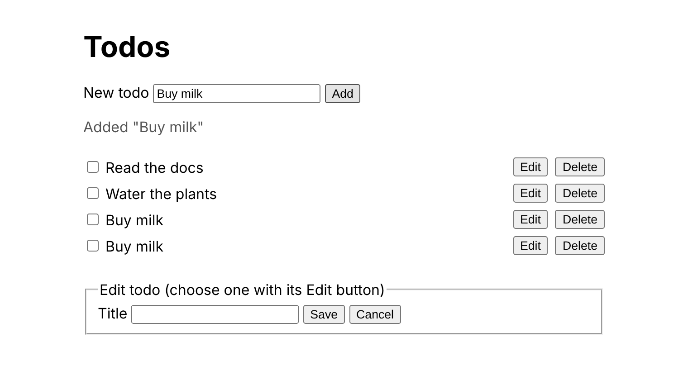
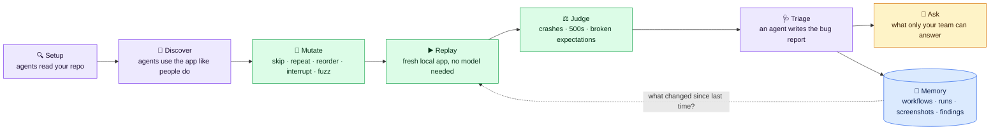

<div align="center">

# 🧬 MutationWorkflow

**Finds the bugs that live between your test cases.**

AI agents learn how people use your app, bend those journeys the way real users do,
replay them against a local copy, and show you what broke, with screenshots.

[](https://github.com/idostolking-lang/MutationWorkflow/actions/workflows/ci.yml)
[](LICENSE)
[](https://nodejs.org)
[](https://www.typescriptlang.org)
[](https://playwright.dev)
[](docs/mcp.md)
[](docs/agents.md)

[Why](#-why) · [How it works](#-how-it-works) · [Quick start](#-quick-start) · [From your coding agent](#-talk-to-it-from-claude-code-codex-or-cursor) · [Run it on push or cron](#-run-it-when-you-want) · [Docs](#-documentation)

</div>

---

## ⏱️ In one minute

Imagine a tireless tester who sits down with your app every night. She reads your code to learn
what it is for, clicks through it like a new customer would, and writes down every journey she
takes: *sign up, add an item, edit it, check out*. Then she does what real people do and your
test suite never does: she clicks **Add** twice, reloads halfway through a form, deletes
something in one tab and saves it in another, opens the admin page as a plain user.

When the app crashes, shows an error, or quietly does the wrong thing, she takes a screenshot,
writes a bug report with the exact steps, and files it. When she is not sure whether something
is a bug or a feature, she asks you. And she **remembers everything**, so the next time you push
a change she knows exactly which journeys to check again.

That tester is MutationWorkflow. It runs on your laptop, in CI on every push, on a schedule, or
around the clock, and it talks to you through the command line or straight from Claude Code,
Codex and Cursor.

> **Why "mutation"?** In classic testing, *mutation testing* changes the **code** to see whether
> the **tests** notice. MutationWorkflow changes the **user journeys** to see whether the
> **application** copes. Same word, opposite direction.

## 🎯 Why

Your tests check the paths you thought of. Users take the others. Three bugs our tiny example
app ships with, and that no ordinary test catches:

| What a real person does                              | What happens                       | Which twist finds it           |
| ---------------------------------------------------- | ---------------------------------- | ------------------------------ |
| Clicks **Add** twice because the first click felt slow | The item is created twice          | *repeat a step*                |
| Deletes an item, then saves the edit form that was still open | The server answers `500`    | *reorder two steps*            |
| Reloads the page in the middle of editing            | A JavaScript error in the console  | *interrupt the journey*        |

MutationWorkflow found all three on its own, from two ordinary workflows. Here is what the first
one looks like in a report:

> ### Submitting a todo twice creates a duplicate
>
> **Severity: high** · Detected by: assertions · Seen 3 times
> Mutation: performs step 3 ("click Add") twice
>
> 1. Open `/`
> 2. Fill **New todo** with "Buy milk"
> 3. Click **Add**
> 4. Click **Add** again *(the mutation)*
>
> Expected exactly one "Buy milk"; found two.
>
> 

Every finding comes with the steps to reproduce it, the screenshots, the console and network
logs, and the exact workflow that triggered it, so a developer can fix it without guessing.

## ⚙️ How it works



🟣 an AI agent thinks · 🟢 deterministic, no model, cheap · 🟡 a human decides · 🔵 memory

1. **Setup.** An inspector agent (fanning out sub-agents) reads the repository: how to start the
   app locally, which features and roles exist, which end-to-end tests already describe intended
   behaviour. It writes the config and turns those tests into the first workflows.
2. **Discover.** Explorer agents drive the *running* app, through a real browser (Playwright)
   for web apps or through the terminal for command-line tools, and record coherent journeys as
   workflows. Every screen they see is captured. Behaviour nobody has confirmed becomes a
   question for your team.
3. **Mutate.** Deterministic operators derive the twists: skip a step, swap two, repeat one,
   abandon midway, reload in between, fuzz the input, swap the role, interleave two journeys. A
   mutator agent can add the twists operators cannot think of.
4. **Replay.** Every workflow, base or mutated, replays in a fresh session against an app the
   tool started itself. No model is involved: replay is fast, cheap and repeatable.
5. **Judge.** Oracles decide what went wrong: the app crashed or threw, a server answered 500,
   an expectation failed, an invariant broke. An app that *refuses* an out-of-order action is
   behaving well, so that is not a bug.
6. **Triage.** A triager agent reads the evidence, writes a precise title and reproduction, sets
   a severity, merges duplicates and dismisses expected consequences of a twist. What it cannot
   judge becomes a question for a human.
7. **Remember.** Workflows, runs, screenshots, findings, questions and model usage live in a
   SQLite database with full-text search, next to Markdown reports. Each workflow also learns
   which pages, endpoints and source files it exercises, so the next run knows what matters.

## 📦 What you get

| | |
| --- | --- |
| 🧭 **Workflows** | The journeys people take through your app, discovered by agents or imported from your existing end-to-end tests. Stored as plain data you can read, edit and version. |
| 🧬 **Mutations** | Nine built-in twists applied to every workflow, deduplicated, plus agent-proposed ones. |
| 📸 **Evidence** | Screenshots of every failure (or of every step, if you ask), console and network logs, DOM captures and transcripts, kept per run under `.mutationworkflow/evidence/`. |
| 🐞 **Findings** | Deduplicated bugs with severity, reproduction steps, the workflows that hit them and the screenshots, embedded in a Markdown report. |
| 🙋 **Questions** | "Is this intended?" asked once, answered by you from the CLI or your coding agent; the answer flows back into workflows and findings. |
| 🧠 **Memory** | One SQLite file. Everything is indexed and searchable; nothing is lost between runs. |
| 🎯 **Change-aware runs** | On a push, only the workflows that touch the changed code replay (plus the ones nobody knows about yet). |
| 🔌 **MCP server** | Claude Code, Codex and Cursor can set it up, run it, read findings and even do the thinking themselves. |

## 🎯 It knows what to run

Every replay records what the app did: the pages visited and the endpoints called. A code map
turns that into the source files behind each workflow, with explicit rules you write or by
finding the literal paths in your repository. So when a push changes the backend and the
frontend of one page, MutationWorkflow replays the workflows that exercise that page, their
mutations, and anything it has never run, and skips the rest.

```sh
mw impact HEAD~1..HEAD        # which workflows does this change affect? (nothing runs)
mw run --changed              # replay just those, since the last run's commit
mw run --changed origin/main..HEAD --trigger push --fail-on high   # the CI version
```

A change to a shared file (a dependency manifest, a lockfile, global config) replays everything,
and so does a project where nothing is known yet. Memory grows with every run.

## 🚀 Quick start

Requirements: Node 22.13 or newer, and a brain for the agent features: your coding agent
(Claude Code or Codex installed, no API key) or an API key with a model you name. Replay,
mutation, judging and reports need no model at all.

```sh
cd your-project
npx mutationworkflow setup       # agents inspect the repo and write mutationworkflow.config.yaml
npx playwright install chromium  # once, for web apps
npx mutationworkflow explore     # agents discover workflows against your local app
npx mutationworkflow mutate      # derive the twists
npx mutationworkflow run         # replay everything, triage, write a report
npx mutationworkflow findings    # what broke, with reproduction steps
npx mutationworkflow questions   # what the agents want you to confirm
```

`mw` is the short alias once installed (`npm i -g mutationworkflow`). Prefer to write the config
yourself? `mw init` gives you a commented template; [docs/configuration.md](docs/configuration.md)
explains every field.

<details>
<summary><strong>Try it on the built-in example</strong> (a todo app with three planted bugs)</summary>

```sh
git clone https://github.com/idostolking-lang/MutationWorkflow && cd MutationWorkflow
pnpm install && pnpm build && pnpm exec playwright install chromium
cd examples/todo-web                                   # ships its mutationworkflow.config.yaml
alias mw=../../packages/mutationworkflow/dist/bin.js
mw explore                        # needs a brain: Claude Code, Codex or an API key
mw mutate                         # 20+ twists from the discovered workflows
mw run                            # finds the planted bugs, writes a report with screenshots
mw impact --file public/app.js    # which workflows does a frontend change affect?
mw run --changed-file public/app.js   # replay just those
```

No model at hand? `pnpm test:e2e` runs the deterministic half of the pipeline in a real browser
and watches it find all three planted bugs from two hand-written workflows.

</details>

## 🤖 Talk to it from Claude Code, Codex or Cursor

MutationWorkflow is also an MCP server. Your coding agent can set it up, run it and discuss
findings with you. Better: connected this way, your coding agent can **be the brain**. It asks
the server for a brief, inspects or explores with its own model and your existing subscription,
and submits the result. No API key, no second model, no extra bill.

```sh
# Claude Code
claude mcp add mutationworkflow -- npx -y mutationworkflow mcp
```

```toml
# Codex: ~/.codex/config.toml
[mcp_servers.mutationworkflow]
command = "npx"
args = ["-y", "mutationworkflow", "mcp"]
```

```json
// Cursor: .cursor/mcp.json
{ "mcpServers": { "mutationworkflow": { "command": "npx", "args": ["-y", "mutationworkflow", "mcp"] } } }
```

Then just ask:

- *"Set up MutationWorkflow for this repo."*
- *"Explore the checkout and run the mutations."*
- *"What did my last commit affect? Replay only that."*
- *"Show me the open findings with their screenshots."*
- *"Is finding fnd_… a real bug?"*

The `setup`, `explore`, `triage` and `mutate` prompts walk the agent through each role; long
operations run as jobs it can poll. See [docs/mcp.md](docs/mcp.md).

## 🕒 Run it when you want

| When | How |
| --- | --- |
| **On command** | `mw run`, or a sentence to your coding agent |
| **On every push** | A GitHub Actions step: `mw run --trigger push --changed <before>..<sha> --fail-on high`, where the range comes from the push event (recipe in [docs/cli.md](docs/cli.md)) |
| **On a schedule** | Cron entries in the config, run by `mw schedule`; `changedOnly: true` replays only what the latest commits touch |
| **Around the clock** | `mw watch` replays, mutates and periodically explores, inside the token and cost budgets you set |

## 🧠 Bring your own model

There is **no default model** and nothing is assumed about your provider. You bring one of three
things:

| | What it uses | Needs a key |
| --- | --- | --- |
| **Your coding agent, over MCP** | Claude Code, Codex or Cursor does the thinking itself with whatever model it runs | no |
| **Your coding agent's command line, as a driver** | `claude -p` or `codex exec` through your installation and subscription (`claude-code`, `codex` providers) | no |
| **A model API** | `anthropic` or `openai` (any OpenAI-compatible endpoint) with a model id you name per role | yes |

"Use up to 3 agents at a time" is one line of config: `agents.maxParallel` caps concurrent model
calls across every agent and sub-agent. Budgets per job stop runaway sessions, every call is
recorded with its estimated cost, and replay never calls a model, so the expensive part happens
only when something is new. Details in [docs/agents.md](docs/agents.md).

## 🔒 Safe by design

- It only ever drives an app **it started locally**, or a localhost URL you point it at. It never
  touches production.
- Agents are fenced by **scope** rules enforced inside the browser before a request leaves, and
  by text patterns naming controls they must never activate (`"Pay"`, `"Delete account"`).
- The config runs the commands you put in it, so review it like code: `mw setup` writes start
  commands proposed by a model and only runs them when you ask with `--validate`.

See [SECURITY.md](SECURITY.md).

## ❓ Questions people ask

**Does it touch my live site?** No. It starts your app locally (or uses a localhost URL you give
it) and refuses anything else unless you opt out explicitly.

**Do I need an API key?** No. Connected to Claude Code, Codex or Cursor it uses their model. With
an API key it uses the model you name. Without any model it still replays, mutates, judges and
reports.

**What does it cost?** Replay is free. Models run only to inspect the repo, discover new journeys,
propose extra twists and write up new findings, under the budgets you set.

**Can I read what it learned?** Yes. Workflows are plain data, findings and reports are Markdown
with screenshots, and the memory is one SQLite file with full-text search.

**My app is not a web app.** Command-line tools work today through stdin and stdout. Adapters
are plugins behind one interface; desktop and game adapters can live in their own packages.

## 🏗️ Architecture

| Package | Role |
| --- | --- |
| `@mutationworkflow/core` | Domain model, config, SQLite memory, environments, operators, oracles, code map, agent runtime, engine |
| `@mutationworkflow/adapter-web` | Playwright adapter for web applications |
| `@mutationworkflow/adapter-cli` | Process adapter for command-line applications |
| `mutationworkflow` | The `mw` command line and the MCP server |

Everything the pipeline does is explained in [docs/architecture.md](docs/architecture.md); the
reasoning behind the bigger choices is recorded in [docs/adr](docs/adr).

## 📚 Documentation

- Concepts: [Workflows](docs/workflows.md) · [Mutations](docs/mutations.md) ·
  [Oracles and findings](docs/oracles.md) · [Agents](docs/agents.md) · [Memory](docs/memory.md) ·
  [Adapters](docs/adapters.md)
- Reference: [Configuration](docs/configuration.md) · [CLI](docs/cli.md) ·
  [MCP server](docs/mcp.md) · [Architecture](docs/architecture.md)

## 🌱 Status

Early and opinionated: version 0.1. The core loop works end to end for web and command-line
applications and is covered by unit tests and real-browser end-to-end tests. Planned next: a
pseudo-terminal driver for full-screen terminal apps, desktop adapters through accessibility APIs,
export and import of workflows as files, a Postgres store for teams, and richer invariants.

Contributions are welcome; start with [CONTRIBUTING.md](CONTRIBUTING.md).

## 📄 License

Apache-2.0. See [LICENSE](LICENSE).
